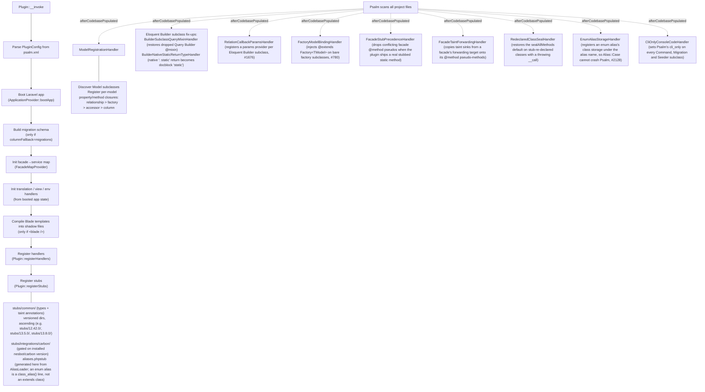
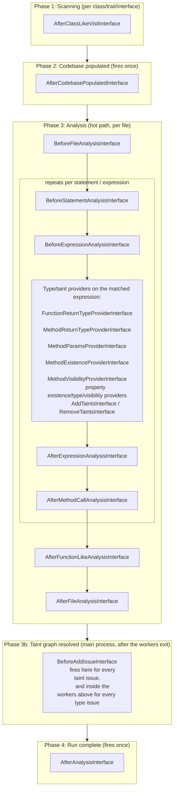

# Contributing

## How the plugin works

The plugin boots a Laravel application, then hooks into Psalm's event system to override type inference for Laravel APIs.

The app is needed at boot time to read config values (e.g. `auth.php` guards), resolve facade aliases via `AliasLoader`, and load service providers.
When run inside a Laravel project, the plugin loads the project's own `bootstrap/app.php`, so it sees the real config, routes, and providers.
When no `bootstrap/app.php` is found (e.g. analyzing a Laravel package, or running the plugin's own tests), it falls back to [Orchestra Testbench](https://github.com/orchestral/testbench) which provides a minimal Laravel app skeleton.

See `ApplicationProvider::doGetApp()` for the resolution logic.



The whole `__invoke` body is wrapped in a try/catch: on any internal error the plugin reports a warning and disables itself for the run (or rethrows when `failOnInternalError` is set). See `src/Internal/InternalErrorReporter.php`.

Bootstrap failures are a special case: `ApplicationProvider` swallows a `bootstrap()` throw to keep the run alive (one bad `config/*.php` must not disable the plugin), so they never reach the try/catch above. `Plugin::__invoke` checks `ApplicationProvider::getBootstrapError()` right after boot and routes it through `InternalErrorReporter::reportDegradedBoot()`: a "degraded mode" warning by default, or escalation to the regular internal-error path when `failOnInternalError` is set (issue #1096). Note that Psalm's `--no-progress` flag installs a `VoidProgress`, which silences all `Progress::warning()` output, including these.

### Blade template analysis

Behind [`<blade />`](../config.md#blade), `Plugin::initBladeAnalysis()` compiles every `*.blade.php` file under the booted app's view paths into a PHP shadow file and registers the result with the run. Handlers then type the shadows, check `view()` call sites against template contracts, carry taint into templates and relocate shadow issues onto the template. [Blade Analysis Internals](blade.md) documents each stage:

| Stage | Where |
|---|---|
| Discovery, compilation, registration, degradation, worker ownership | [Pipeline and lifecycle](blade.md#pipeline-and-lifecycle) |
| Which Blade handler registers on which gate | [Handler registration](blade.md#handler-registration) |
| Shadow cache, invalidation, inspecting a shadow | [Shadow cache](blade.md#shadow-cache) |
| Ambient variables, class component seeding, runtime helpers | [Template typing](blade.md#template-typing) |
| Contracts, composer keys, read sets | [Contracts and read sets](blade.md#contracts-and-read-sets) |
| `view()` data and component properties as taint | [Taint bridge](blade.md#taint-bridge) |
| Shadow issue to template issue | [Issue remapping](blade.md#issue-remapping) |
| `blade:annotate` | [Annotation implementation](blade.md#annotation-implementation) |

Changing which Blade handlers `Plugin::registerHandlers()` registers, or their gates, updates the table under [Handler registration](blade.md#handler-registration) in the same PR.

## Getting started

```bash
git clone git@github.com:psalm/psalm-plugin-laravel.git
cd psalm-plugin-laravel
composer install
composer test        # lint + psalm + unit + type tests
```

## Running tests

```bash
composer test          # full suite (lint + psalm + unit + type)
composer test:unit     # PHPUnit unit tests only
composer test:type     # type tests only (psalm-tester)
composer psalm         # self-analysis of plugin source
composer test:app      # creates a fresh Laravel project, scaffolds common class types (`make:xxx`), installs the plugin, and runs Psalm on the result
LARAVEL_INSTALLER_VERSION=12.12.2 composer test:app # run over a specific Laravel version

# single test file
./vendor/bin/phpunit tests/Unit/PluginConfigTest.php
./vendor/bin/phpunit --filter=AuthTest tests/Type/
```

### Measuring a PR on real-world apps (`/psalm-delta`)

Maintainers can comment `/psalm-delta` on a PR to run the plugin's base and head on the apps in [`bin/ci/test-apps.yml`](../../bin/ci/test-apps.yml) and get a sticky comment with the per-app issue delta. It is informational and never fails the PR.

- `/psalm-delta` runs the `default` group.
- `/psalm-delta octane vito` adds group tags and app names to `default` (spaces or commas). Pick the groups that exercise your change, e.g. `ai` for `laravel/ai` stubs, `blade` for view resolution or view taint, or `filament` for Filament-heavy code.
- `/psalm-delta all` runs every app; `/psalm-delta help` replies with the groups and their apps.
- A token starting with `--` is a flag for `psalm-laravel analyze` on both sides of every selected app, e.g. `/psalm-delta blade --blade` runs `default` plus the `blade` group with Blade template analysis on, and `/psalm-delta --find-dead-code` reports unused code (`UnusedClass`, `PossiblyUnusedMethod`, ...) that `psalm.xml` disables. `--find-unused-psalm-suppress` and `--find-unused-variables` likewise turn on Psalm reports that `psalm.xml` disables (suppressions made redundant, unused variables and params). `--experimental` enables the [experimental opt-in rules](../config.md#experimental) to measure their false-positive rate, and `--plugin-option=modelProperties.columnFallback=none` shows how much model typing depends on migration parsing. Flags are case-sensitive; group and app names are not. Accepted flags are those declared under `flags:` in `bin/ci/test-apps.yml` (add one there to allow it) plus any `--plugin-option=KEY=VALUE`, e.g. `/psalm-delta blade --blade --plugin-option=findMissingViews=true`. A flag the base plugin predates crashes the base side.

To reproduce locally (needs `yq`), run `bash bin/ci/delta.sh --apps "octane vito" <pr-branch>` (flags go in the same string: `--apps "blade --blade"`).

## Code style

- PER Coding Style 3.0 (powered by php-cs-fixer: run `composer cs` to apply fixes)
- Explain decisions and ideas in comments

```bash
composer cs     # auto-fix style issues
composer rector # run rector refactoring
```

## How to add a stub

Stubs override Laravel's type signatures. Place them in:

- `stubs/common/`: shared across Laravel versions (includes both type stubs and taint annotations)
- `stubs/<version>/`: version-specific overrides, loaded when the installed Laravel is `>=` the dir name (`version_compare`). Both major-only (`stubs/13/`) and patch-level (`stubs/13.8.0/`) names work
- `stubs/integrations/<package>/`: optional stubs for third-party packages, gated on the package being installed. Carbon uses the `shared/` + `pre-3.12/` conditional-directory pattern in `src/Stubs/CarbonStubProvider.php`; `laravel-ai/` is one flat directory, see [the gate](#the-laravelai-integration-gate).

Rules:
- Verify signatures against actual Laravel code (not against Laravel PHPDoc or method signatures)
- Add a type test in `tests/Type/tests/` to prevent regression
- For taint annotations, see [Taint Analysis Stubs](taint-analysis.md)
- A closure parameter whose callback runs bound to another object (`Artisan::command('x', function () { $this->comment(); })`) is typed with `@param-closure-this \Foo $callback` on the stubbed method, not a handler. A facade needs a real static method in its stub for this: `@method static` cannot carry the tag, and `FacadeStubPrecedenceHandler` drops the generated pseudo-method when the stub declares a real one. A `static` closure stays `InvalidScope`, which matches runtime.

### The `laravel/ai` integration gate

`LaravelAiIntegration::isEnabled()` (laravel/ai `>=1.0.0 <2.0.0`) is the only version check. `stubs/integrations/laravel-ai/` is one flat tree of namespace subdirectories mirroring `Laravel\Ai\` (`Contracts/`, `Responses/`, ...): a new stub goes at the path of the class it redeclares. Four things load behind `Plugin::laravelAiIntegrationEnabled()` and must stay in lockstep, because a partial set is a silent half-integration:

1. The stubs, via `Plugin::optionalIntegrationStubs()` / `StubFileFinder::integrationStubs()`.
2. `Handlers\Ai\LlmOutputTaintHandler` (`Plugin::registerHandlers()`): property-read sources that docblocks cannot express ([why](taint-analysis.md#property-source-pattern-response-text-handler-required)).
3. `Handlers\Ai\PromptGuardTaintHandler` (`Plugin::registerHandlers()`): exempts a `prompt()` / `stream()` call site whose agent middleware `handle()` carries `@psalm-taint-escape llm_prompt` ([mechanics](taint-analysis.md#how-the-prompt-guard-exemption-reads-an-escape-annotation)). Emission-time and stateless, so it needs no `resetInvocationState()` entry.
4. `Internal\PromptInjectionIssuePolicy` (`Plugin::__invoke()`): keeps Psalm's `TaintedLlmPrompt` error by default and suppresses it only for `<findPromptInjection value="false" />`. Without the stubs it could suppress a project's own `llm_prompt` annotations.

A new gated site calls `laravelAiIntegrationEnabled()` instead of copying the version check. A new integration follows the same shape: one shared `isInstalled()` + `satisfies()` gate used at every call site, stubs under a new `stubs/integrations/<package>/`. `LaravelAiIntegration::diagnostic()` reports the state, e.g. `enabled (laravel/ai 1.0.0; requires >=1.0.0 <2.0.0)`.

### Stub merging: how Psalm combines annotations

When **multiple stub files declare the same method on the same class**, Psalm reuses a single MethodStorage object and re-applies docblock parsing. The merging rules differ by annotation kind:

- **Type annotations** (`@return`, `@param`): last-loaded file wins (direct assignment `=`).
- **Parameter-level taint annotations** (`@psalm-taint-sink`, `@psalm-assert-untainted`): last-loaded file wins. Each re-declaration rebuilds the parameter storages (`FunctionLikeNodeScanner` calls `setParams([])`), so sinks from an earlier file are dropped, not OR-ed. Verified on Psalm 7.0.0-rc1: an `html` sink in one stub plus an `sql` sink on the same parameter in a later stub reports only `TaintedSql`.
- **Method-level taint annotations** (`@psalm-taint-source`, `@psalm-taint-escape`, `@psalm-taint-unescape`): all files accumulate (bitwise OR `|=` on the reused MethodStorage).

Splitting annotations for the same method across two stub files is therefore fragile: which type and which sinks survive depends on load order. Always put all of them in the same file, and have an override restate every `@psalm-taint-sink` of the declaration it replaces.

When a **class stub and a trait stub** both declare the same method, Psalm creates **separate** MethodStorage objects, one per class/trait. There is no cross-merging: if `Connection.phpstub` overrides a method defined in `ManagesTransactions.phpstub`, the trait's annotations (including taints) are ignored for that method. To keep both type and taint annotations, put them on the class stub.

Registration order (`Plugin::registerStubs()`): all `common` files, then version dirs ascending (`array_merge`). Since type annotations are last-loaded-wins, this order (not alphabetical path) decides overrides.

A stub that re-declares a class merges into the class's vendor file only when Psalm scans the vendor file first. Psalm records a scanned stub as the class's file and then never queues the vendor file. A class that nothing names before stubs load therefore ends up with only its stubbed members (#1616, upstream vimeo/psalm#12075). `Plugin::registerStubs()` queues every class a plugin stub declares (`StubFileFinder::declaredClassLikes()`) during plugin init, which runs before Psalm's main scan, so a partial stub can rely on its unstubbed vendor members resolving. The same init window queues the classes the container's bindings resolve to (`ContainerResolver::queueBoundClassesForScanning()`, once, after stub registration, results discarded so analysis reads the live container), because `app()` narrowing names them; the former scan hook on the Application/Container interfaces re-ran every `make()` on each visit (2-5 times per run) and queued the classes while stubs were registering, so Psalm scanned them as stubs.

#### `laravel/ai` parity checker, `@since` and `@stub-waive`

Psalm cannot see stub-versus-vendor drift ([why](taint-analysis.md#optional-third-party-integrations-stubsintegrationspackage)), so `bin/ci/check-laravel-ai-stub-parity.php` diffs the stubs against the installed package (no argument scans all of `stubs/integrations/laravel-ai/`). `tests/Unit/Ci/LaravelAiStubParityCheckerTest.php` pins the script's own checks.

- It compares native parameter/return types and each class's `implements` list (minus what the real parent supplies). Docblock narrowing beyond native types is expected, not drift.
- A real member the stub omits is reported as a taint-review tripwire, not a correctness failure: Psalm merges it in from the vendor class, but with no taint annotations.
- Properties need no gate: a stub property the installed class lacks is never reported, and a trait-provided property is covered by mirroring the class's `use` clause (see `Tools/SimilaritySearch.phpstub`).
- A real member the stub omits fails the run unless the class docblock waives it with `@stub-waive` (below); nothing is allow-listed in the script.

**`@since X.Y.Z`** tags anything a 1.x minor added after the `1.0.0` floor, so the checker skips it while the installed release is older. Method: tag its docblock. The tag also gates a method the older release already has but whose signature a later minor changed (e.g. an appended parameter): the checker skips that method's whole signature diff, and does not count it as compared, while installed < tag. `implements` / interface `extends` entry: one `@since X.Y.Z implements \Fully\Qualified\Interface` line per interface in the class docblock. Whole class: a standalone `@since X.Y.Z` line in its class docblock (reported as version-gated, not compared). A name or class the installed release lacks, or a class with no tag, is still reported.

**`@stub-waive`** lets a stub leave out a member that carries no taint or type value instead of restating it. In the class docblock, one line per member: `@stub-waive withMaxTokens() <reason>`, `@stub-waive $runtimeTools <reason>` or `@stub-waive implements \Fully\Qualified\Interface <reason>`. A trailing `*` waives a family by name prefix: `@stub-waive assert*() <reason>` (or `$prefix*` for properties). The `*` is a prefix marker only at the very end of a name (`*Timeout()` and `get*Timeout()` are not targets), and a bare `*` is an error, because a blanket waiver would delete the tripwire this tag exists to keep. Wildcards belong to the class docblock; in a docblock of a member the stub does declare, a bare `@stub-waive <reason>` instead waives drift of that member's own signature. The reason is mandatory (a tag without one fails the run), every waived member is still printed on its own line with its reason under "Waived by @stub-waive" (also when a wildcard covered it), and a waiver or wildcard that matches nothing (the member reappeared in the stub or left the vendor class) is reported as a `::warning::` so it gets deleted.

**Waive sparingly: the stubs are deliberately NOT partial.** The completeness rule is what found the real gaps in this integration's security review (`Promptable::withMessages()`, the classification question criteria and `AssistantMessage::__construct()` were each missing, and each was caught because a member was absent or unstubbed). A new member of a prompt-facing or response class is where a new sink or source lands, so those classes must keep failing CI until someone has reviewed the member. Waive a member only when its parameters cannot carry text toward a model and its return cannot carry text from one. Test doubles qualify (`fake()`, `isFaked()`, `assert*()` on `Audio`, `Image`, `Embeddings`, `Reranking`, `Classification` and `Promptable`), and so do builder setters that take only scalars or enums (`timeout()`, `limit()`, `withMaxTokens()`). Anything touching prompts, messages, tools, documents or responses does not qualify, even when it carries no annotation today: restate it. Do not widen a wildcard to cover a family you have not read member by member, and check each matched member against `vendor/laravel/ai/src` first, since a prefix also matches methods added later.

### Version-specific overrides (conditional stub loading)

A file in a version dir (`stubs/13.16.0/...`, loaded when installed Laravel `>=` that version) overrides the same-named `common` file **per method**. Multiple version dirs cascade ascending: per method, the highest dir `<=` the installed version wins; a method it doesn't redeclare falls through to lower dirs, then `common`. (Verified: with `common` + `12.6.0` + `12.8.0` all declaring `MessageBag::has`, `12.8.0` won; `missing()` declared only in `12.6.0` survived; `isEmpty()` came from `common`.)

Authoring an override:

- Declare only the changed methods; the rest merge from `common`.
- Repeat the `implements` clause (interface stubs: the `extends` list) verbatim, because a re-declaration resets Psalm's `class_implements` / `parent_interfaces` and silently strips contracts. Class `extends` and trait `use` survive, but copy the full header anyway to stay diffable against Laravel source.
- Types and parameter sinks replace, method-level taints accumulate (see "Stub merging"), so restate every `@psalm-taint-sink` of the method you override.

**Common vs version dir.** Return narrowing that holds across all versions (Laravel only improved its annotation) goes in `common`. A parameter widened by behavior present only in a newer Laravel (e.g. `firstOrNew`'s `values` taking `\Closure|array` only on 13) must go in the version dir: widening `common` would tell Psalm a call is valid that fatals at runtime on older versions (silent false negative).

### Testing version-specific stubs

A type test that asserts a `stubs/<version>/` override would fail on the lower cells of the CI matrix (`.github/workflows/tests.yml` runs `test:type` over the highest 12.x and 13.x), because the override does not load on the older Laravel. Gate such a test with a `--SKIPIF--` section so it runs only where the stub applies:

```
--SKIPIF--
<?php
require getcwd() . '/vendor/autoload.php';
\Tests\Psalm\LaravelPlugin\Type\LaravelVersion::skipBelow('12.42.0');
--FILE--
... assertion of the version-specific behavior ...
```

`LaravelVersion::skipBelow($version)` skips when the installed Laravel is older than the stub dir (`skipFrom($version)` does the reverse for behavior only on older lines). The `--SKIPIF--` script runs in a bare process from the project root, so it requires the autoloader via `getcwd()`. See `tests/Type/tests/Http/PendingRequestTest.phpt` for a worked example (the async HTTP client types are 12.42+).

## How to add a handler

Handlers implement Psalm event interfaces to override type inference.
Create the handler class in the appropriate `src/Handlers/` subdirectory, then register it in `Plugin::registerHandlers()`.
`CollectionGroupByKeyByHandler` specializes literal model attributes for collection `groupBy()` and `keyBy()` calls; unsupported forms defer to Laravel's stubs.
`ConditionableWhenHandler` narrows the return type of `Conditionable::when()`/`unless()`. `ConditionableCallbackParamsHandler` types their closure-literal callback params from the receiver and the `$value` narrowed to truthy/falsy. It is a params provider registered per host class, because params providers dispatch on the called class, not on the declaring trait.
Most taint handlers live under the Laravel feature directory whose API they cover (e.g. `Handlers/Eloquent/WhereColumnTaintHandler`); a stop-gap for an upstream Psalm bug that applies to every call site regardless of Laravel domain goes in `Handlers/Taint/` instead (e.g. `NamedArgumentTaintHandler`, vimeo/psalm#12251).
`Tappable::tap()` has no handler: its `$callback is null` conditional return lives in `stubs/common/Support/Traits/Tappable.phpstub`. Psalm before 7.0.0-rc8 collapsed such a conditional return in a stub that re-declares a reflected method to a single branch (vimeo/psalm#11837); `CollectionRandomTest.phpt` and the `tap()` type tests pin that it no longer does.

`RelationCallbackParamsHandler` types the closure-literal callback of Eloquent relation-query methods (`whereHas()`, `has()`, `whereRelation()`, `withWhereHas()`, `whereHasMorph()`, ...):

- Registration and receiver: a params provider per Eloquent `Builder` subclass (params providers dispatch on the called class and carry no receiver). The receiver's model is recovered from the call node via a `beforeExpressionAnalysis` stash keyed by the first arg, as in `ConditionableCallbackParamsHandler`, for builder, custom-builder, static (`Model::whereHas()`) and Relation receivers.
- Contracts: plain slots get the related model's builder (its custom builder when it has one); `withWhere*()` slots get `Builder|Relation` (the closure also runs as the eager-load constraint); morph slots get `($q, $type)` over the literal types.
- Declines: anything not provably one model's builder keeps the stub signature (union receivers, userland overrides of the method or of a method it delegates to, a related or owner model whose `newEloquentBuilder()` override yields no registered custom builder (docblock-only, interface or union return type), non-literal names or types, MorphTo on a dot path, a possible `static::class` leak, ...); the handler docblock lists them.

`BelongsToManyWithPivotHandler` adds the literal `withPivot()` and `withTimestamps()` columns to TPivotModel (`Pivot&object{role: string}`), typed from the pivot table's migration (`mixed` when unknown) through `Support\PivotColumnResolver`, which `RelationMethodParser` shares so callers of a relation method see the same shape. The parent's timestamp columns are dates only when the chain provably keeps the plain pivot and the app's `Date::use()` class is known. Behind `using(X::class)` it builds `X&object{...}` from X's own types first (#1998). It declines for a union receiver, a `$table` argument that may name a model class, and a factory called on another model (#1944). `ModelRelationReturnTypeHandler` keeps a relation method's own declared pivot shape for its callers.

`JsonEncodeTaintHandler` is a second `Handlers/Taint/` handler: core Psalm clears html from `json_encode()` with `JSON_HEX_TAG | JSON_HEX_AMP` but keeps the quoted-text taint by design, so this handler clears it for literal `JSON_HEX_APOS | JSON_HEX_QUOT | JSON_HEX_AMP` (including the Blade `@json` directive's defaults). It is permanent, not a stop-gap: core rejected the has_quotes half (vimeo/psalm#12453).

### Experimental issue lifecycle

Experimental status changes an issue's default severity, never whether its handler or type inference runs. Keep the experimental policy list in `ExperimentalIssuePolicy` as the single source of truth; `PromptInjectionIssuePolicy` is a separate, integration-gated opt-out for the stable `TaintedLlmPrompt` issue. Both policies delegate to `Internal\DefaultIssueLevels`, which implements the safe setter Psalm lacks: it applies a default only when the project has no handler for that issue, and recognizes its own earlier default by object identity so a later invocation can refresh it when the flag flips. Any explicit issue handler owns the complete reporting policy, including its base level and scoped filters.

1. Introduce an experimental issue: register its handler normally, add its issue type to that internal list, and let the policy default it to `info` (or `error` when `<experimental value="true" />` is configured). Set `ERROR_LEVEL` on the issue class now, choosing the nearest Psalm core analogue and naming it in a one-line comment: the level is dormant while the policy owns the default, and applies unchanged at graduation.
2. Graduate an issue: remove it from the internal list. Psalm then gates it on its `ERROR_LEVEL` like its own issues: an `error` for projects at that level or stricter, `info` for looser ones. `tests/Unit/Internal/IssueErrorLevelTest.php` pins each level.
3. Withdraw an issue: remove its handler and issue class.

Do not add user-facing feature names or handler-registration gates. Do not overwrite or merge explicit issue handlers.

### Psalm hooks used by the plugin

Psalm processes code in phases. Each hook fires at a specific phase and has different data available.
Analysis hooks are hot paths, they fire on every matching expression. Scanning hooks fire once per class or once total.
Source of truth for which handler implements which hook: `Plugin::registerHandlers()` plus each handler's `implements` clause.



### Registering handlers

There are two ways to register:

1. **Class-level** (most handlers): implement the interface, register via `$registration->registerHooksFromClass(MyHandler::class)` in `Plugin::registerHandlers()`
2. **Closure-level** (model property handlers): register via `$providers->property_type_provider->registerClosure(...)`, used by `ModelRegistrationHandler` to bind property handlers per-model after codebase is populated

Every class registration keeps the matching `require_once` beside
`registerHooksFromClass()`.

`ModelAggregateLoadHandler` (`AfterExpressionAnalysisInterface`) is the reference for flow facts: after a literal `$m->loadCount('x')` or `$m = M::withCount('x')->firstOrFail()` it writes `$context->vars_in_scope['$m->x_count']`, which Psalm's property fetch reads before any property provider, and it overrides the node type of a directly fetched chain (`M::withCount('x')->firstOrFail()->x_count`). Its only state is the set of aliases it recorded per variable id, so `$m->refresh()` can drop those facts without touching user narrowings; `reset()` clears it from `Plugin::resetInvocationState()`. It gates on the node class and method name before touching the codebase and declines (`null`) on anything not proven. See [Architecture Decisions](decisions.md), "Aggregate accessor proof".

#### Exempting one call site from a stub's taint sink

Narrow the finding at emission time, not in the taint graph.
`ResponseFactoryTaintHandler` is the reference shape: it implements only
`BeforeAddIssueInterface`, matches the issue's journey tail against the sink's
labels, re-checks the call site, and returns `false` to drop the finding. Graph
level removal (`RemoveTaintsInterface`) cannot express "this call site only" and
leaks onto shared flow edges; [Architecture Decisions](decisions.md) records why,
along with the alternatives already ruled out.

Such a handler has to be stateless, because the analysis hooks run in the worker
processes and taint issues are emitted only after those exit. Re-derive every fact
from the issue plus `Codebase::getStatementsForFile()`, which reads the parser
cache. The hook fires for every issue in the run, so bail on the issue class first
and only then do anything expensive. Every uncertain path returns `null` and keeps
the finding.

#### Dropping a false positive Psalm raises per receiver atomic

`Collections\EmptyCollectionLookupIssueHandler` (`BeforeAddIssueInterface`, registered from `registerHooksFromClass()` before `Blade\BladeIssueRemapHandler`) drops the `expects never` argument issue a lookup (`get`/`has`/`contains`/...) raises on an empty `Collection<never, never>` (#1814). It bails on the issue class, the method id and the message before it touches storage, then resolves the declaring method from storage (Laravel's collections only) and compares the quoted expected type with its parameter whose class templates are replaced by `never`; every miss returns `null` and keeps the issue. Stateless, so no `reset()`. Rationale and the rejected stub widenings: [Architecture Decisions](decisions.md), "Lookups on an empty collection".

See [Architecture Decisions](decisions.md) for design rationale, [Laravel Magic Call Patterns](laravel-magic-call-patterns.md) for how Laravel's __call/__callStatic chains work, [Psalm Type Syntax](types.md), [Docblock Annotations](annotations.md) and [Purity and Capabilities](purity.md) for Psalm references, [Blade Analysis Internals](blade.md) for template analysis behaviour, and [Debugging with Xdebug](xdebug.md) for stepping through handler code.

## External resources

- [Authoring Psalm Plugins](https://psalm.dev/docs/running_psalm/plugins/authoring_plugins/)
